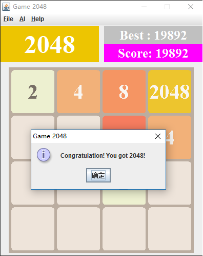

# Game2048
A Java Swing version of 2048 with an AI player. Move the tiles with the arrow keys, or open the **AI** menu and let the computer play:
**Random** makes random moves, and **MiniMax** uses the Minimax algorithm to look ahead and pick each move.

**[Play it in your browser](https://mattsi.github.io/Game2048/)** (runs the original Java Swing app with CheerpJ; the first load can take up to a minute)



## Run locally

You need Java 8 or later and Maven.

```bash
mvn package
java -cp target/Game2048-0.0.1-SNAPSHOT.jar com.propig.game.Game2048.GameSwing
```
